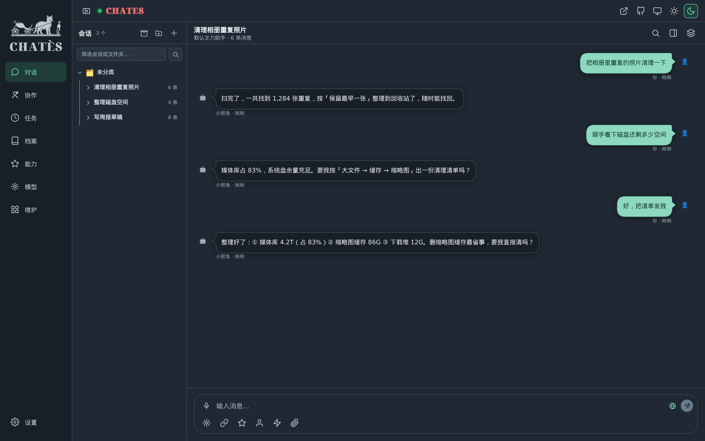
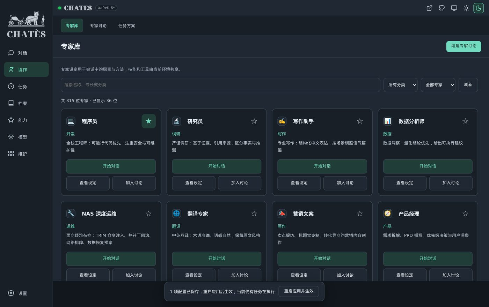
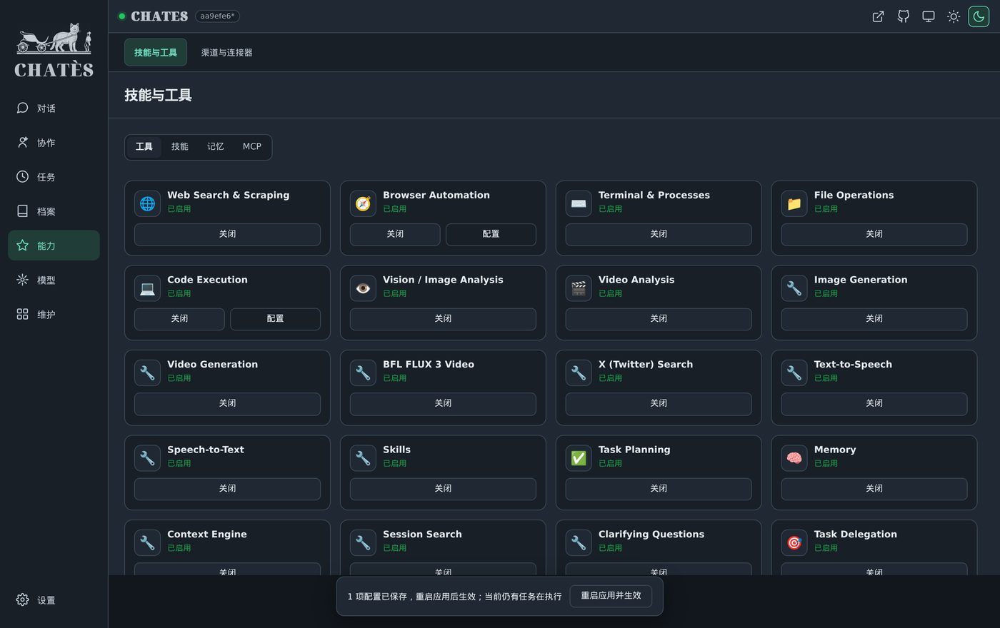
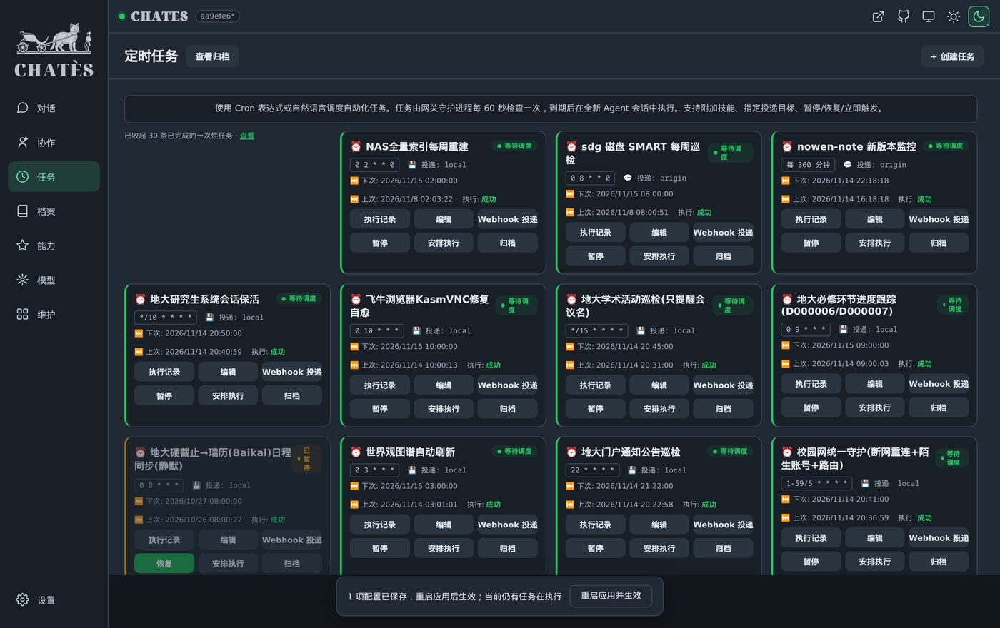
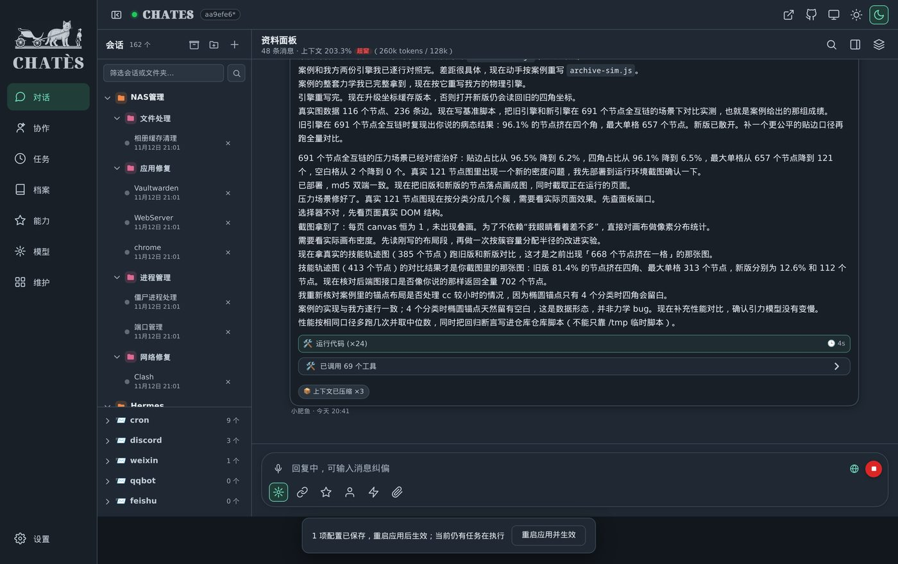

<p align="center">
  <picture>
    <source media="(prefers-color-scheme: dark)" srcset="app/ui/images/logo-cat-full-light.png">
    
  </picture>
</p>

<p align="center">
  <b>一个双击就能用的 AI 助手，自己装着、自己拆得动</b><br/>
  <sub>Hermes Agent 内核 · 自建控制面板 · Windows 安装器 · fnOS 应用包</sub>
</p>

<p align="center">
  
  
  
  
  
  
</p>

<p align="center">
  <a href="https://vector9584.github.io/chates/">项目主页</a> ·
  <a href="https://github.com/vector9584/chates/releases/latest">下载</a> ·
  <a href="docs/DOWNLOAD.md">下载慢怎么办</a> ·
  <a href="docs/ARCHITECTURE.md">仓库结构</a> ·
  <a href="JOURNEY.md">改造历程</a>
</p>

---

## 这是什么东西

一个跑在你自己机器上的 AI 助手。能连二十来种模型，能接微信、QQ、飞书、Telegram，能自己定闹钟干活，能记住上次聊到哪儿，还能自己写工具给自己用。

原版只有命令行。这个仓库给它配了一个真正的控制台——八个板块、二十一个页面，聊天、定时任务、技能开关、模型凭据、知识库全在里面点。另外还有一层 Windows 安装器，装完桌面上就是一个图标，双击就开。

**不需要 WSL，不需要 Git，不需要管理员权限。**

## 仓库里哪部分是哪个

根目录一打开一百多项平铺，看着乱——因为**上游 Hermes 内核**和**CHATÈS 加的层**混在一起了。判据很简单：

| 你看到的 | 是什么 | 能动吗 |
|---|---|---|
| `agent/` `hermes_cli/` `tools/` `skills/` `web/` `providers/` `plugins/` `gateway/` `cron/` `locales/` `tests/` 和根目录那堆 `*.py` | 上游 Hermes 内核，原样保留 | 别动，改它 import 就炸 |
| `app/` `electron/` `win/` `cmd/` `config/` `wizard/` `release-tools/` `data-skeleton/` `kernel/` `fpk-bin/` `manifest` | CHATÈS 自己的：面板 + 打包链 | 改这里 |
| `README.md` `RELEASE.md` `ARCHITECTURE.md` `JOURNEY.md` `WORK-MEMORY.md` `UPDATE-LOG.md` | 文档 | 随便改 |

完整清单和每个目录干什么，见 [docs/ARCHITECTURE.md](docs/ARCHITECTURE.md)。

## 装哪个

两个形态，共用同一个内核和面板：

| 你的机器 | 装什么 | 怎么装 |
|---|---|---|
| **Windows** | [CHATES-Setup-*.exe](https://github.com/vector9584/chates/releases/latest) | 下载双击，一路下一步 |
| **fnOS / 飞牛** | [hermes-agent_*.fpk](https://github.com/vector9584/chates/releases/latest) | 应用中心 → 手动安装 → 选这个文件 |

Windows 版装在 `%APPDATA%\CHATÈS`，**升级不覆盖你的配置**：`.env`、`config.yaml`、`SOUL.md`、笔记、知识库、会话记录，一个字节都不动，只换程序本体。

> fpk 装之前请确认应用中心里已经有 `nodejs_v24`。装的时候它会让你确认一次依赖变更，点确认即可。

## 打开之后长这样



左边一列是板块，中间是列表，右边是内容。所有配置都是纯文本文件（`SOUL.md`、`MEMORY.md`、`AGENTS.md`、`config.yaml`），你想手改就手改，改完刷新就生效。

<table>
<tr>
<td width="50%"></td>
<td width="50%"></td>
</tr>
<tr>
<td align="center"><sub>协作 · 315 位专家，按分类筛，一键加入讨论</sub></td>
<td align="center"><sub>能力 · 技能与工具逐项开关，不用记配置项</sub></td>
</tr>
<tr>
<td width="50%"></td>
<td width="50%"></td>
</tr>
<tr>
<td align="center"><sub>任务 · cron 与自然语言建任务，带执行历史</sub></td>
<td align="center"><sub>对话 · 流式输出、工具卡、断线续发</sub></td>
</tr>
</table>

## 二十一个页面都在干什么

导航以 `app/ui/js/panel-navigation.js` 顶部的 `groups` 数组为唯一真源，当前 **8 个板块、21 个页面**。

| 板块 | 页面 | 干什么 |
|---|---|---|
| **对话** | 会话 | 流式输出、工具卡、气泡状态、发送队列与断线续发、斜杠命令、选项卡片 |
| **协作** | 专家库 · 专家讨论 · 任务方案 | 315 位角色，按分类筛；圆桌多 Agent 讨论；把讨论结论落成可执行方案 |
| **任务** | 定时任务 | cron 与自然语言建任务、执行历史、前后置钩子、结果投递 |
| **档案** | 提示词 · 知识库 · 留痕录 | `SOUL.md`／`MEMORY.md`／`AGENTS.md` 都是纯文本，技能与记忆直接改 |
| **能力** | 消息渠道 · 外接工具 · 工具集 · 技能 | 逐项启用、关闭、配置，对应上游 toolsets 与通道接口 |
| **模型** | 概览 · 模型选择 · 服务商 · 能力后端 · 配置 | 供应商凭据、模型池、按域绑定生图与语音等能力后端 |
| **维护** | 运行状态 · 用量统计 · 本地版本 | 进程状态、日志按级别与组件筛、每次会话 token 用量 |
| **设置** | 偏好设置 | 主题与界面偏好 |

前端是静态 HTML + CSS + 原生 JS，**没有打包器**。`index.html` 里 `<script>` 的顺序就是依赖顺序——改一行刷新就能看见，代价是顺序不能乱挪。这条写进了 `app/ui/ARCHITECTURE.md`。

当前面板侧：**45 个 `panel-*.js`、18,326 行**。技能 **397 个**，知识库笔记 **1,100 篇**。

## 怎么证明没改坏

改内核最怕的就是「面板还能开，但某个功能悄悄死了」。所以每轮改动都跑同一套门禁：

```bash
npm run check     # 四个 workspace 的测试 + lint
```

覆盖 `apps/shared`（23 文件 / 225 测试）、`ui-tui`（138 文件 / 1,529 测试）、`web`（22 文件 / 156 测试）、`tests-js`（3 文件）。**185 个测试文件、1,915 个测试**，加上 eslint，全绿才算过。最近一次跑：退出码 0，0 error、41 warning。

面板侧另有静态检查脚本，盯着两件最容易出事的：`<script>` 顺序、以及 `panel-*.js` 之间不该出现的循环引用。

## 想一起改

**前端四条规矩**（改出过一次全站白屏，所以定死了）：

1. `index.html` 里 `<script>` 的顺序就是依赖顺序，不许乱挪
2. 块注释里不许出现 `*/` 字面量——通配符、正则、URL 尾巴都不行
3. 新页面必须在 `panel-navigation.js` 的 `groups` 里登记，否则导航找不到
4. 改完必须 bump 资源的 `?v=`，否则浏览器给你看老的

**后端**：`app/python/` 是对上游 Python 层的补丁，不是另写一套。上游代码改动能落回 `agent/`、`gateway/`、`hermes_cli/`，就别在补丁层再糊一遍。

**提交前**：

```bash
npm run check          # 测试 + lint
bash release-tools/build-fpk.sh --tag <tag>   # 打 fpk（含版本递增门禁）
```

## 已知限制

- **fpk 只能走应用中心 UI 装**。`fnos-cli app install-fpk` 在应用声明了 `install_dep_apps` 时会拒绝，报 `dependency app changes that require App Center UI`——这是 CLI 的硬判定，绕不过。命令行装会返回 `code 10236`。
- **Windows 大文件下载慢**。这台机器直连 `objects.githubusercontent.com` 只有 20–68 KB/s。Release 页下 exe 建议挂代理，`ghproxy.net` 实测能到 371 KB/s。
- **升级不动配置**：exe 用 `.seeded` 标记 + `force:false`，fpk 的 `app.tgz` 里没有 `data/` 条目——这是设计出来的，不是巧合。
- 面板不做打包器，所以没有 tree-shaking、没有模块解析。好处是透明，坏处是文件一多就得靠约定维持顺序。

## 上游与许可

内核是 [Nous Research 的 Hermes Agent](https://github.com/NousResearch/hermes-agent)，MIT。本仓库的内核部分（`agent/`、`gateway/`、`hermes_cli/`、`tools/` 等）沿用 MIT；面板与安装器部分 GPL-3.0。

上游基线 `715201b`，之上 **69 个提交**，主要是 Windows 兼容层、面板配置事务、会话状态拆分，以及 cron 与 gateway 的若干修复。完整清单在 `UPDATE-LOG.md`。
